Turning messy data into clear insights with clean analysis and meaningful visuals.

---

<h2 align="center">🚀 About Me</h2>

Hi, I'm Rohit, a **BBA (E-Commerce) graduate** from R.C. Patel Arts, Commerce and Science College, Shirpur (KBCNMU, Jalgaon).

My degree gave me a strong base across **technology, accounting, and management**, which helps me understand the business side behind the data, not just the code.

I'm currently learning **Data Science with AI** and building my skills for data analyst and data science roles.

**Currently learning:** Machine Learning, SQL, and AI-based data projects.

**My goal:** To become a skilled **Data Specialist** who uses data to solve real business problems, with interests in **FinTech**, **E-commerce analytics**, and **MIS / Business Analyst** roles.

 

---

<h2 align="center">🤝 Connect</h2>

<table>
<tr>
<td align="center" width="96"><a href="https://github.com/rohitttdurangiii"><picture><source media="(prefers-color-scheme: dark)" srcset="https://cdn.simpleicons.org/github/white" /><source media="(prefers-color-scheme: light)" srcset="https://cdn.simpleicons.org/github/181717" /></picture></a> <b>GitHub</b></td>
<td align="center" width="96"> <b>LinkedIn</b></td>
<td align="center" width="96"> <b>Gmail</b></td>
</tr>
</table>

  <a href="mailto:rohitttdurange@gmail.com?subject=Hello%20Rohit">📧 Send Email</a> |
  <a href="https://mail.google.com/mail/?view=cm&fs=1&to=rohitttdurange@gmail.com&su=Hello%20Rohit">Open in Gmail (browser)</a>

rohitttdurange@gmail.com

---

<h2 align="center">💻 Tech Stack</h2>

<table>
<tr>
<td align="center" width="96"> <b>Python</b></td>
<td align="center" width="96"> <b>NumPy</b></td>
<td align="center" width="96"> <b>Pandas</b></td>
<td align="center" width="96"> <b>Matplotlib</b></td>
<td align="center" width="96"> <b>Seaborn</b></td>
<td align="center" width="96"> <b>Excel</b></td>
<td align="center" width="96"> <b>Power BI</b></td>
<td align="center" width="96"> <b>SQL</b></td>
<td align="center" width="96"> <b>ML</b></td>
<td align="center" width="96"> <b>Jupyter</b></td>
<td align="center" width="96"> <b>Git</b></td>
<td align="center" width="96"> <b>VS Code</b></td>
</tr>
</table>

---

<h2 align="center">📊 GitHub Stats</h2>

---

<h2 align="center">📈 Activity Graph</h2>

  

<picture>
  <source media="(prefers-color-scheme: dark)" srcset="https://raw.githubusercontent.com/rohitttdurangiii/rohitttdurangiii/output/github-contribution-grid-snake-dark.svg" />
  <source media="(prefers-color-scheme: light)" srcset="https://raw.githubusercontent.com/rohitttdurangiii/rohitttdurangiii/output/github-contribution-grid-snake.svg" />
  
</picture>

